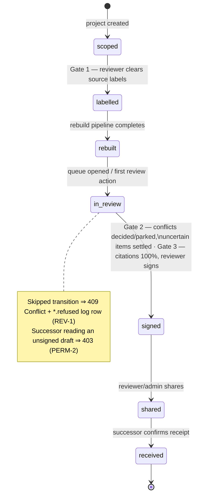
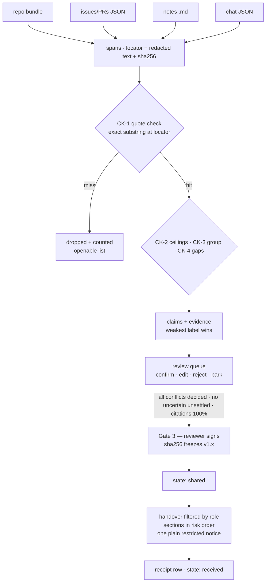

# Architecture — Tether, Round 2 (D4)

> Structure adapted from the external reference build's architecture document (`docs/reference-other-agent/ARCHITECTURE.md`) with its stack corrected to this repository. Everything below describes **this** codebase; names and paths are real files. The reference doc claims a React/Vite/Express/Next.js app with a gitleaks binary — none of that is this build.

Single Python process (FastAPI + uvicorn) serving a static SPA and one JSON API; SQLite via a single read path; no build step; one constants module (`backend/app/config.py`); one label policy (`backend/app/policy/labels.py`).

## 1. High-level system architecture

```mermaid
graph TD
    subgraph Sources [Authorised input sources]
        G[Git repo bundle<br/>commits & files]
        M[Markdown meeting notes]
        C[Chat export JSON<br/>Slack-style]
        IP[Issues & PRs JSON<br/>GitHub REST shape]
        X[Excluded channels<br/>#hr-leave · #private-*]
    end

    subgraph Trust [Trust & sanitisation layer]
        SEC[Built-in secret scanner<br/>AWS keys, key blocks, assignments<br/>pipeline/clean.py · SEC-2]
        PII[PII masking<br/>phones, emails]
        INJ[Injection quarantine<br/>"ignore previous instructions"<br/>pipeline/clean.py · SEC-3]
        EX[In-memory exclusion<br/>excluded channels dropped,<br/>never persisted · SEC-1]
    end

    subgraph Pipeline [6-stage reconstruction pipeline]
        S1[1. Read & parse<br/>readers/readers.py · RD-1, RD-2]
        S2[2. Cut & clean<br/>spans · sha256]
        S3[3. Pull claims<br/>llm/adapter.py<br/>replay | rules | live]
        S4[4. Validate<br/>schema + CK-1 exact quote<br/>substring at locator]
        S5[5. Group & compare<br/>CK-2 ceilings · CK-3 conflicts · CK-4 gaps]
        S6[6. Fill review queue]
    end

    subgraph Storage [Ledger & access control]
        DB[(SQLite<br/>tether.db · WAL)]
        RP[Single read path<br/>db/read_path.py · PERM-4]
        AL[Append-only audit log<br/>hash-chained sha256]
    end

    subgraph Views [Role-filtered interfaces]
        V_REV[Reviewer<br/>queue · conflicts · Gate 1/2/3 sign]
        V_SUC[Successor<br/>signed v1.0 only · risk order<br/>one plain restricted notice · PERM-1/2]
        V_ADM[Admin<br/>retention · export · delete · log]
        V_LEAVE[Leaver<br/>own-work proposals]
    end

    G & M & C & IP --> S1
    X -->|dropped before storage| EX
    S1 --> S2 --> SEC & PII & INJ --> S3
    S3 --> S4
    S4 -->|no exact quote| DROP[dropped + counted<br/>openable list]
    S4 -->|quote at locator| S5 --> S6 --> DB
    DB --> RP
    RP -->|reviewer / admin| V_REV & V_ADM
    RP -->|successor · latest signed only| V_SUC
    RP -->|leaver · own work| V_LEAVE
    DB --> AL
```

*Plain text: the browser talks only to the FastAPI process. The process holds no other service; the LLM is a file (replay), a pattern set (rules), or a network call (live, optional). All SQL lives in `read_path.py`.*

## 2. Project state machine & gate transitions



*Plain text: seven states — `scoped, labelled, rebuilt, in review, signed, shared, received` (`config.PROJECT_STATES`); every skipped transition returns 409 with a `*.refused` log row (REV-1). States are enforced server-side, not by the UI.*

## 3. Evidence model & weakest-source visibility

```mermaid
graph LR
    subgraph Evidence [Evidence items]
        E1[open source: file config/rate_limiter.ts#L3-3]
        E2[internal source: notes/2026-08-10.md P2]
    end
    subgraph Claim [Claim record]
        C[Claim: rate limit is 60/min\nconfidence min(0.95, weakest evidence ceiling)]
        L[Derived label: INTERNAL\nweakest-source wins · HR-2]
    end
    subgraph RLS [Row-level filtering via read_path]
        R1[Reviewer/Admin: visible]
        R2[Successor: filtered by label]
        N[If any row hidden ⇒ ONE plain notice,\nno title, no count · PERM-1]
    end
    E1 & E2 --> C --> L
    L --> R1 & R2
    R2 -->|restricted rows hidden| N
```

*Plain text: a claim takes the weakest label among its evidence; the successor sees only what the role may read, and never a hint about what is missing.*

An **evidence** row ties `quote` + `locator` + `source_label` + `captured_at` to a clean, redacted **span** (locator + text + sha256). A claim exists only if CK-1 found its quote at its locator as a character-for-character substring. Signing hashes `payload = {version number, items: risk-ordered claims with citations, gaps, risk_rule, decided conflicts}` (see `_signed_payload` in `backend/app/api/main.py`) — later edits create a new draft; nothing mutates a signed version.

## Data flow, source → signed handover



## Corrections applied while adopting this structure

| The reference document says | This repository actually does |
|---|---|
| React 19 / Vite / Tailwind / Express (`DISCLOSURES.md` there) | static vanilla SPA + FastAPI; no Node, no build step ([decisions/0005](decisions/0005-static-spa-no-build.md)) |
| Gitleaks scanner binary | built-in regex scanner `pipeline/clean.py` (binary unavailable offline; SEC-2 proves the redactions) |
| `tests/tether.test.ts`, 21 tests via tsx | `python3 -m pytest backend/tests` — 48 passed, 1 skipped (E2E-1, browser-dependent) |
| “100% citation pass rate” as shipped | gates enforce no unsettled uncertain items and all conflicts decided; the CK-1 drop count is reported, never hidden (see `reports/verify.md`) |
| Gate 3 = CA/citation gate | Gates: Gate 1 labels · Gate 2 queue settled · Gate 3 sign (see `backend/app/api/main.py` `sign_version`) |

## Design records

See [decisions/](decisions/): 0001 SQLite over Postgres · 0002 replay fixtures provenance · 0003 fail-closed citation gate · 0004 fixture union for identical chunks · 0005 static SPA, no build step.
