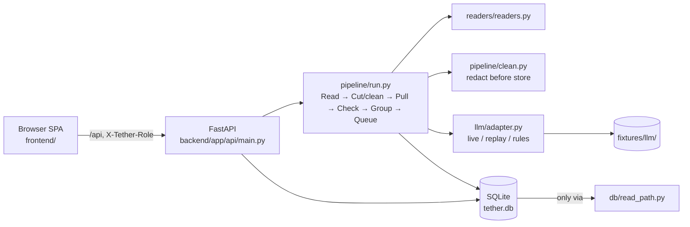
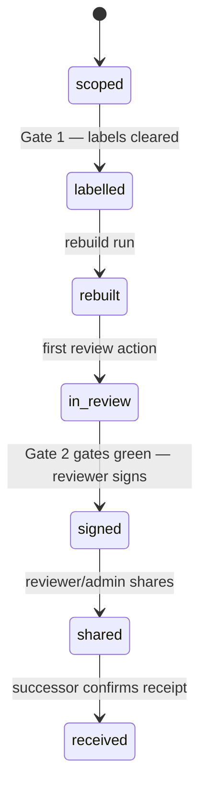

# Architecture — Tether, Round 2

Single Python process (FastAPI + uvicorn) serving a static SPA and one JSON API; SQLite via a single read path; no build step; one constants module (`backend/app/config.py`); one label policy (`backend/app/policy/labels.py`).

## System

*Plain text: the browser talks only to the FastAPI process. The process holds no other service; the LLM is a file (replay), a network call (live), or patterns (rules); all SQL lives in `read_path.py`.*

## Data flow, source → signed handover

*Plain text: anything without a matching quote never becomes a claim; a person decides every conflict; the signed version is the only thing the successor can open.*

## Project state machine

*Plain text: seven states; every skipped transition returns 409 with a `*.refused` log row (REV-1).* States are `scoped, labelled, rebuilt, in review, signed, shared, received` in `config.PROJECT_STATES`.

## Evidence model

A **claim** (`claims`) has zero or more **evidence** rows (`evidence`), each tying quote + locator + source label + capture time to a **span** (`spans`). A claim's label is the *weakest* among its evidence (HR-2): one restricted source makes the claim restricted. The handover shows a claim only if the viewer's role may read that label; the citation endpoint additionally fails closed when *every* claim citing a span is unreadable by the role. Signing hashes `payload = {version number, items: risk-ordered claims with citations, gaps, risk_rule, decided conflicts}` (see `_signed_payload` in `main.py`) — later edits create a new draft version; nothing mutates a signed one.

## Design records

See [decisions/](decisions/): 0001 SQLite over Postgres · 0002 replay fixtures provenance · 0003 fail-closed citation gate · 0004 fixture union for identical chunks · 0005 static SPA, no build step.
