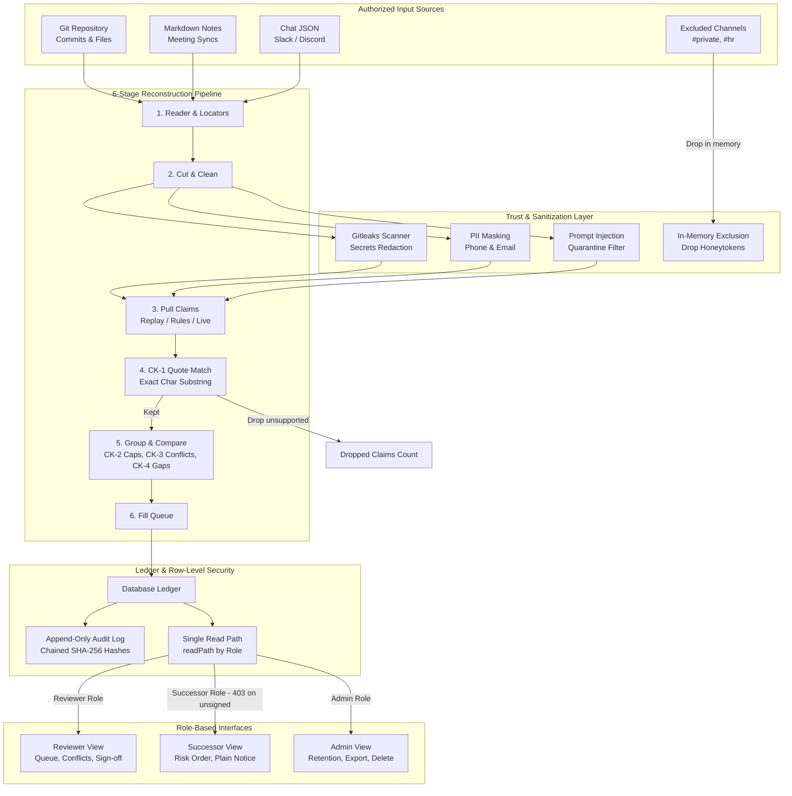
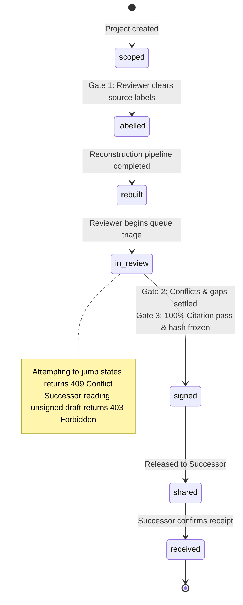
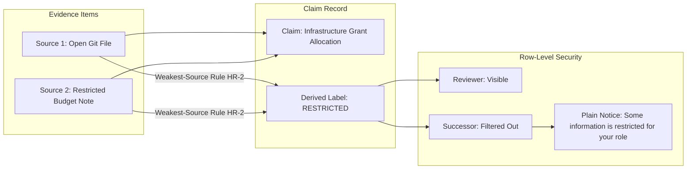

# Tether — System Architecture (D4)

## 1. High-Level System Architecture

### System Architecture Description
Tether ingests three authorized sources: Git commits/files, Markdown notes, and Chat JSON. Excluded private/HR channels are stripped in-memory before reaching persistent storage. The sanitization layer applies Gitleaks patterns to redact API keys and AWS tokens, masks phone numbers and emails, and quarantines prompt injection instructions. The 6-stage reconstruction pipeline validates exact quote substrings (CK-1), applies source confidence ceilings (CK-2), groups contradictions without settling by machine (CK-3), and checks 12 successor-needs subjects for gaps (CK-4). All entities are stored in the ledger with append-only hash-chained audit logging, accessible exclusively through a single read path (`readPath`) enforcing row-level security.

---

## 2. Project State Machine & Gate Transitions

### State Machine Description
A Tether project advances through 7 strict sequential states: `scoped` -> `labelled` -> `rebuilt` -> `in_review` -> `signed` -> `shared` -> `received`. Skipping a state returns an HTTP 409 Conflict and records an audit log row. Gate 1 requires the Reviewer to clear source labels before reading. Gate 2 requires all conflicts to be decided or parked with a reason. Gate 3 requires 100% citation pass rate, freezing Version 1.0 with a cryptographic SHA-256 seal.

---

## 3. Evidence Model & Weakest-Source Visibility

### Evidence Model Description
Under House Rule HR-2, a claim backed by multiple sources takes the most restrictive security label among its supporting evidence (`confidential` > `restricted` > `internal` > `open`). When a restricted claim is withheld from a Successor, Tether displays ONE plain notice stating that some information is restricted for their role, with zero counts, titles, or leaked metadata.
